# oxkv 1.0 dependency DAG

| Field | Value |
| --- | --- |
| Status | Proposed |
| Date | 2026-11-12 |
| Scope | The 32 essays, the five core contracts, the annexes, and the wave gates |
| Normative source | `specs.md` section 7.24 and section 10.1 |
| Owner | Architecture review |

## 1. Purpose

This document records the dependency graph for the 32 essays. It follows the
wave table in section 7.24. It follows the prerequisites in section 10.1.

The graph has three node kinds:

- A **foundation node** is a shared registry or harness. Foundation nodes live
  in wave 0.
- A **contract node** declares a frozen surface. A contract node may appear
  before the implementation that uses it.
- An **implementation node** builds behavior behind a declared contract. Each
  implementation node names one contract node.

The graph obeys these rules:

- A contract node comes before every implementation node that uses it.
- An implementation node does not define a new contract behavior.
- A wave gate uses only nodes from its wave or an earlier wave.
- No wave gate requires a test from a later wave.
- The graph is acyclic. Section 6 records which section 10.1 edges this
  document reverses and why.

## 2. Foundation nodes (wave 0)

These nodes are the shared 1.0 contract foundation in `crates/oxkv-contracts`.

| Node | Surface | Source |
| --- | --- | --- |
| `K-ERR` | Canonical error and receipt registry | `oxkv_contracts::error` |
| `K-VER` | Qualified version axes, provenance, content digest, and content seal | `oxkv_contracts::version` |
| `K-CUR` | The eight cursor token types | `oxkv_contracts::cursor` |
| `K-RCP` | The four receipt states and the receipt envelope | `oxkv_contracts::receipt` |
| `K-KEY` | Reserved system identifiers and keyspace validation | `oxkv_contracts::keyspace` |
| `K-VEC` | Golden vector runner skeleton | `crates/oxkv-contracts/tests/vectors` |
| `K-ADR` | Architecture decision records and freeze governance | `docs/specs` |
| `K-FAULT` | Fault-injection harness skeleton | Qualification work |

This issue delivers `K-ERR`, `K-VER`, `K-CUR`, `K-RCP`, `K-KEY`, and
`K-VEC`. `K-ADR` and `K-FAULT` are separate wave 0 work. The graph lists them
because the wave 0 gate names them.

## 3. Contract nodes

A contract node names one frozen surface. The wave column is the earliest wave
that may declare the node.

| Node | Essay | Contract | Wave | Prerequisites |
| --- | --- | --- | --- | --- |
| `C-05` | 05 | `key-encoding/v1` | 1 | `K-KEY`, `K-VER` |
| `C-06` | 06 | `snapshot-page/v1` | 1 | `C-05`, `K-VER` |
| `C-07` | 07 | `oxkv/manifest/v1` | 1 | `C-05`, `K-VER` |
| `C-08` | 08 | `policy-ast/v1` | 1 | `C-07` |
| `C-09` | 09 | Versioned write and conflict semantics | 1 | `C-05`, `C-06`, `C-07`, `C-08`, `K-ERR`, `K-RCP` |
| `C-10` | 10 | `receipt-error/v1` and outbox semantics | 1 | `C-09`, `K-ERR`, `K-RCP` |
| `C-13` | 13 | `scope/v1` | 1 | `C-07`, `C-08`, `C-10`, `C-22` |
| `C-19-PIN` | 19 | `read-pin/v1` | 1 | `C-10`, `C-14` |
| `C-22` | 22 | `oxkv/map/v1` | 1 | `C-05`, `C-07` |
| `C-14` | 14 | `sync-wire/v1` | 1 | `C-05`, `C-06`, `C-10`, `C-13` |
| `C-24` | 24 | `oxkv/event/v1` | 1 | `C-07`, `C-09`, `C-10` |
| `C-17` | 17 | `projection/v1` | 1 | `C-07`, `C-08`, `C-09`, `C-10` |
| `C-29-AUTH` | 29 | `audit/v1` authentication and audit part | 1 | `C-07`, `C-09`, `C-10` |
| `C-25-LAYER` | 25 | `descriptor/v1` RPC layering part | 1 | `C-07`, `C-10`, `C-14` |
| `C-11` | 11 | Scheduler contract | 2 | `C-09`, `C-10`, `C-22` |
| `C-12` | 12 | Enforcement contract | 2 | `C-08`, `C-09`, `C-10`, `C-11`, `C-17`, `C-24`, `C-29-AUTH` |
| `C-27` | 27 | Rule lifecycle contract | 2 | `C-07`, `C-08`, `C-09`, `C-10`, `C-12`, `C-13`, `C-17`, `C-24` |
| `C-18` | 18 | `tokenizer/v1` | 3 | `C-06`, `C-07`, `C-19-PIN` |
| `C-19` | 19 | Snapshot-consistent search contract | 3 | `C-13`, `C-14`, `C-18` |
| `C-16` | 16 | Hydration contract | 3 | `C-06`, `C-14`, `C-19` |
| `C-15` | 15 | Replica contract | 3 | `C-06`, `C-13`, `C-14`, `C-16`, `C-18`, `C-19` |
| `C-20` | 20 | `cost/v1` | 3 | `C-07`, `C-13`, `C-18`, `C-19` |
| `C-23` | 23 | Bounded staleness contract | 3 | `C-10`, `C-14`, `C-15`, `C-19-PIN` |
| `C-21` | 21 | Replication seam contract | 4 | `C-06`, `C-09`, `C-10`, `C-11`, `C-13`, `C-14`, `C-24` |
| `C-22-FINAL` | 22 | Final `oxkv/map/v1` contract | 4 | `C-22`, `C-05`, `C-07`, `C-13` |
| `C-28` | 28 | `migration/v1` | 5 | `C-06`, `C-07`, `C-09`, `C-10`, `C-17`, `C-21`, `C-22-FINAL`, `C-23`, `C-24`, `C-27`, `C-29-AUTH` |
| `C-26` | 26 | Consumer contract | 5 | `C-07`, `C-10`, `C-22`, `C-24`, `C-28` |
| `C-27-FULL` | 27 | Full rule lifecycle contract | 5 | `C-27`, `C-13`, `C-17`, `C-24` |
| `C-29` | 29 | Full security contract | 6 | `C-07`, `C-08`, `C-09`, `C-12`, `C-13`, `C-14`, `C-15`, `C-17`, `C-19`, `C-20`, `C-25-LAYER`, `C-27-FULL`, `C-28` |
| `C-28-FULL` | 28 | Final backup, restore, and migration contract | 6 | `C-28`, `C-29` |
| `C-30` | 30 | Qualification contract | 6 | Every other contract node in waves 1 to 6 except `C-31` and `C-32`, `K-VEC` |
| `C-31` | 31 | Falsifier contract | 6 | `C-30`, `C-05`, `C-06`, `C-07`, `C-09`, `C-10`, `C-11`, `C-13`, `C-14`, `C-15`, `C-16`, `C-17`, `C-18`, `C-19`, `C-20`, `C-22`, `C-23`, `C-28`, `K-VEC` |
| `C-32` | 32 | 1.0 freeze contract | 7 | Every contract node in waves 1 to 6 |

## 4. Implementation nodes

Each implementation node names its contract node. The contract node is the
primary surface. The prerequisite column lists the build dependencies.

| Node | Essay | Contract node | Wave | Prerequisites |
| --- | --- | --- | --- | --- |
| `I-01` | 01 | `C-05` | 1 | None |
| `I-02` | 02 | `C-05` | 1 | `I-01`, `C-06` |
| `I-03` | 03 | `C-08` | 1 | `I-01`, `C-07`, `C-08` |
| `I-04` | 04 | `C-06` | 1 | `I-01`, `C-05`, `C-06`, `C-09`, `C-10` |
| `I-05` | 05 | `C-05` | 1 | `C-05`, `C-07`, `C-22` |
| `I-06` | 06 | `C-06` | 1 | `I-05`, `C-07`, `C-17` |
| `I-07` | 07 | `C-07` | 1 | `C-05`, `C-07`, `C-22` |
| `I-08` | 08 | `C-08` | 1 | `C-07`, `C-08` |
| `I-09` | 09 | `C-09` | 2 | `I-05`, `I-07`, `I-08`, `C-10`, `C-11` |
| `I-10` | 10 | `C-10` | 2 | `I-09`, `C-14` |
| `I-11` | 11 | `C-11` | 2 | `I-09`, `I-10`, `C-22` |
| `I-12` | 12 | `C-12` | 2 | `I-08`, `I-09`, `I-10`, `I-11`, `C-17`, `C-24`, `C-29-AUTH` |
| `I-17` | 17 | `C-17` | 2 | `I-07`, `I-08`, `I-09`, `I-10`, `C-24` |
| `I-24-OUTBOX` | 24 | `C-24` | 2 | `I-03`, `I-07`, `I-09`, `I-10`, `I-11`, `I-17` |
| `I-27` | 27 | `C-27` | 2 | `I-07`, `I-08`, `I-09`, `I-10`, `I-12`, `I-17` |
| `I-13` | 13 | `C-13` | 3 | `I-07`, `I-08`, `I-10`, `C-14`, `C-22` |
| `I-14` | 14 | `C-14` | 3 | `I-05`, `I-06`, `I-10`, `C-13` |
| `I-15` | 15 | `C-15` | 3 | `I-06`, `I-13`, `I-14`, `C-16`, `C-18`, `C-19` |
| `I-16` | 16 | `C-16` | 3 | `I-06`, `I-14`, `I-15`, `C-19` |
| `I-18` | 18 | `C-18` | 3 | `I-06`, `I-07`, `C-19-PIN` |
| `I-19` | 19 | `C-19` | 3 | `I-13`, `I-14`, `I-18`, `C-18` |
| `I-20` | 20 | `C-20` | 3 | `I-07`, `I-13`, `I-18`, `I-19` |
| `I-23` | 23 | `C-23` | 3 | `I-10`, `I-14`, `I-15`, `I-19`, `C-23` |
| `I-21` | 21 | `C-21` | 4 | `I-04`, `I-09`, `I-10`, `I-11`, `I-13`, `I-14`, `C-24` |
| `I-22` | 22 | `C-22-FINAL` | 4 | `I-05`, `I-07`, `I-13`, `C-22-FINAL` |
| `I-23-SLO` | 23 | `C-23` | 4 | `I-23`, `I-21`, `C-23` |
| `I-24-CONSUMER` | 24 | `C-24` | 5 | `I-03`, `I-07`, `I-09`, `I-10`, `I-11`, `I-17`, `C-26` |
| `I-25` | 25 | `C-25-LAYER` | 5 | `I-07`, `I-10`, `I-14`, `I-24-CONSUMER`, `C-25-LAYER` |
| `I-26` | 26 | `C-26` | 5 | `I-03`, `I-07`, `I-10`, `I-22`, `I-24-CONSUMER`, `I-25`, `C-28` |
| `I-27-LIFECYCLE` | 27 | `C-27-FULL` | 5 | `I-07`, `I-08`, `I-09`, `I-10`, `I-12`, `I-13`, `I-17`, `I-24-CONSUMER`, `C-27-FULL` |
| `I-28` | 28 | `C-28` | 6 | `I-06`, `I-07`, `I-09`, `I-10`, `I-17`, `I-21`, `I-22`, `I-23`, `I-24-CONSUMER`, `I-27`, `C-28` |
| `I-29` | 29 | `C-29` | 6 | `I-07`, `I-08`, `I-09`, `I-12`, `I-13`, `I-14`, `I-15`, `I-17`, `I-19`, `I-20`, `I-25`, `I-27`, `I-28`, `C-29` |
| `I-30` | 30 | `C-30` | 6 | `K-VEC`, `C-30`, every contract node in waves 1 to 6 except `C-31`, every implementation node in waves 1 to 5, `I-28`, `I-29` |
| `I-31` | 31 | `C-31` | 6 | `I-30`, `C-31`, the implementation nodes for 05, 06, 07, 09, 10, 11, 13, 14, 15, 16, 17, 18, 19, 20, 22, 23, and 28 |
| `I-32` | 32 | `C-32` | 7 | `I-15`, `I-17`, `I-21`, `I-24-CONSUMER`, `I-27-LIFECYCLE`, `I-28`, `I-29`, `I-30`, `I-31`, `C-32` |

## 5. Wave gates

Each gate uses only nodes in its wave or an earlier wave. The final column
lists the nodes that prove the gate.

| Wave | Gate | Gate evidence | Highest wave used |
| --- | --- | --- | --- |
| 0 | Registries approved and DAG checked in | `K-ERR`, `K-VER`, `K-CUR`, `K-RCP`, `K-KEY`, `K-VEC`, `K-ADR`, `K-FAULT` | 0 |
| 1 | Cross-contract review and candidate vectors | `C-05`, `C-06`, `C-07`, `C-08`, `C-09`, `C-10`, `C-13`, `C-14`, `C-17`, `C-19-PIN`, `C-22`, `C-24`, `C-25-LAYER`, `C-29-AUTH`, `I-01` to `I-08`, `K-VEC` | 1 |
| 2 | Write terminal state, atomic event, audit record, and local projection | `C-11`, `C-12`, `C-27`, `I-09` to `I-12`, `I-17`, `I-24-OUTBOX`, `I-27` | 2 |
| 3 | Offline scope read and search, resume, fallback, and cost explain | `C-15`, `C-16`, `C-18`, `C-19`, `C-20`, `C-23`, `I-13` to `I-16`, `I-18`, `I-19`, `I-20`, `I-23` | 3 |
| 4 | Leader kill, stale epoch, and bounded staleness | `C-21`, `C-22-FINAL`, `I-21`, `I-22`, `I-23-SLO` | 4 |
| 5 | Email demo, control RPC, and canary rollback | `C-26`, `C-27-FULL`, `C-28`, `I-24-CONSUMER`, `I-25`, `I-26`, `I-27-LIFECYCLE` | 5 |
| 6 | Backup and restore, migration, fuzz, and falsifiers | `C-28-FULL`, `C-29`, `C-30`, `C-31`, `I-28`, `I-29`, `I-30`, `I-31` | 6 |
| 7 | Freeze register complete and support policy published | `C-32`, `I-32` | 7 |

No gate row names a node from a later wave. A gate does not close on a test
that a later wave supplies.

## 6. Cycle resolutions

Section 10.1 contains five cycles. This document reverses one edge per cycle.
The reversed edge keeps the wave order and the contract-before-implementation
rule.

| Cycle | Section 10.1 edges | Resolution |
| --- | --- | --- |
| Key, manifest, and map | 05 needs 07 and 22; 07 needs 05 and 22; 22 needs 05 and 07 | `C-05` declares the key grammar first. `C-07` uses `C-05`. `C-22` uses `C-05` and `C-07`. |
| Scope and wire | 13 needs 14; 14 needs 13 | `C-13` declares the scope query first. `C-14` uses `C-13`. |
| Replica and hydration | 15 needs 16; 16 needs 15 | `C-16` declares the hydration surface first. `I-15` uses `C-16`. `I-16` uses `I-15`. |
| Index and search | 18 needs 19; 19 needs 18 | `C-18` declares the tokenizer surface first. `C-19` uses `C-18`. `I-18` uses `C-19-PIN`. `I-19` uses `I-18`. |
| Bounded staleness and replication | 23 needs 21; 21 is declared in wave 4, 23 in wave 3 | `C-23` uses `C-19-PIN` and the read path contracts. `I-23-SLO` uses `I-21` in wave 4. |

The event contract also reverses one edge. Section 10.1 lists item 11 as a
prerequisite of item 24. `C-24` is declared in wave 1 and `C-11` is declared
in wave 2. The event envelope does not need the scheduler. `I-24-OUTBOX` uses
`I-11`.

The operations contract also reverses one edge. Section 10.1 lists the full
security contract as a prerequisite of item 28. `C-28` uses the wave 1
`C-29-AUTH` part. `I-28` uses the full `C-29` in wave 6.

## 7. Validation checklist

- [ ] Every node has one wave.
- [ ] Every implementation node names one contract node.
- [ ] Every contract node has a version and a vector corpus.
- [ ] Every edge points to a node in the same wave or an earlier wave.
- [ ] No contract node uses an implementation node from a later wave.
- [ ] No wave gate uses a node from a later wave.
- [ ] The graph has no cycle.
- [ ] The wave 0 registries match `crates/oxkv-contracts`.
- [ ] The vector runner accepts one new case per contract version.

## 8. Wave overview

```mermaid
flowchart LR
    W0["Wave 0<br/>K-ERR, K-VER, K-CUR, K-RCP, K-KEY, K-VEC, K-ADR, K-FAULT"]
    W1["Wave 1<br/>Contracts 05, 06, 07, 08, 09, 10, 13, 14, 17, 19 pin, 22, 24, 25 layer, 29 auth<br/>Implementations 01 to 08"]
    W2["Wave 2<br/>Contracts 11, 12, 27<br/>Implementations 09 to 12, 17, 24 outbox, 27"]
    W3["Wave 3<br/>Contracts 15, 16, 18, 19, 20, 23<br/>Implementations 13 to 16, 18 to 20, 23"]
    W4["Wave 4<br/>Contracts 21, 22 final<br/>Implementations 21, 22, 23 SLO"]
    W5["Wave 5<br/>Contracts 26, 27 full, 28<br/>Implementations 24 consumer, 25, 26, 27 lifecycle"]
    W6["Wave 6<br/>Contracts 28 full, 29, 30, 31<br/>Implementations 28, 29, 30, 31"]
    W7["Wave 7<br/>Contract 32<br/>Implementation 32 final qualification"]

    W0 --> W1 --> W2 --> W3 --> W4 --> W5 --> W6 --> W7
```

The wave arrows are gate order only. The tables in sections 3 and 4 are the
normative edges.
